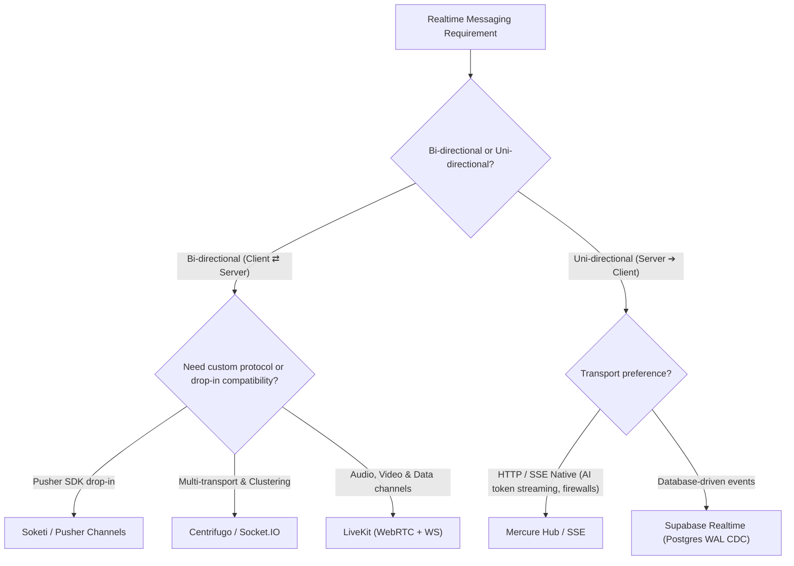

# ⚡ Awesome Realtime Messaging

  

  
  
  
  
  
  
  

---

> 🚀 **The definitive curated directory of high-performance Realtime Messaging tools, WebSocket infrastructure, Server-Sent Events (SSE) hubs, Presence Tracking protocols, and PostgreSQL Change Data Capture (CDC) streaming engines.**

Whether you are building multiplayer collaborative apps, real-time live chat systems, financial order-book tickers, IoT telemetry pipelines, or AI token-streaming endpoints, this guide indexes both battle-tested **SaaS PaaS solutions** and production-grade **Self-Hosted Open-Source frameworks**.

---

## 📑 Table of Contents

- [📊 Sector Overview & Market Dynamics](#-sector-overview--market-dynamics)
- [☁️ SaaS / Hosted Realtime Platforms](#️-saas--hosted-realtime-platforms)
- [🛠️ Open-Source Realtime Messaging Engines](#️-open-source-realtime-messaging-engines)
- [💡 Architectural Patterns & Protocol Selection](#-architectural-patterns--protocol-selection)
- [🤝 How to Contribute](#-how-to-contribute)
- [📈 Star History](#-star-history)
- [💖 Support & Sponsoring](#-support--sponsoring)
- [⚖️ License & Disclaimer](#️-license--disclaimer)

---

## 📊 Sector Overview & Market Dynamics

- **Estimated Market Size**: The global **Real-Time Communication (RTC) and Realtime Messaging PaaS market** was valued at approximately **$4.8 Billion in 2024** and is projected to expand to over **$14.2 Billion by 2030–2032**, demonstrating an accelerating compound annual growth rate (**CAGR of ~21.5%**). Growth is catalyzed by remote collaboration suites, interactive live streaming, fintech trading systems, and low-latency LLM token streaming.
- **Market Dynamics & Fragmentation**: The sector exhibits **moderate fragmentation rather than a winner-take-all monopoly**. While mega-cloud hyperscalers (AWS AppSync, Google Firebase) command broad default enterprise adoption, dedicated specialist PaaS providers (Pusher, Ably, PubNub) maintain high retention through dedicated multi-region edge routing and strict 99.999% SLAs. Concurrently, data privacy regulations (GDPR, HIPAA), edge latency, and egress cost avoidance have driven explosive developer migration toward **modern open-source self-hostable engines** (Centrifugo, LiveKit, Soketi, Supabase Realtime).

---

## ☁️ SaaS / Hosted Realtime Platforms

The following hosted platforms provide managed real-time messaging, WebSockets, and pub/sub channels without self-managing server infrastructure. Entries are sorted by **Company Valuation / Revenue (descending)**.

| 🌐 Platform | 🏢 Company Scale (Valuation / Revenue) | 💳 Starting Paid Tier | 🎁 Free Forever / Free Trial Limits | ⚡ Key Capabilities & Protocol Focus |
| :--- | :--- | :--- | :--- | :--- |
| **[Google Firebase](https://firebase.google.com/)** | **~$2.1 Trillion Market Cap** *(Alphabet parent; Google Cloud ARR ~$40B+)* | **$5.00 / GB stored + $1.00 / GB egress** *(Blaze Plan pay-as-you-go; $0 base fee)* | **Spark Plan (Free forever)**: 1 GB storage, 10 GB/mo network transfer, 100 simultaneous WebSocket connections | Realtime JSON tree synchronization across clients; automatic offline caching; native Google Cloud Auth & Cloud Functions hooks. |
| **[AWS AppSync](https://aws.amazon.com/appsync/)** | **~$1.9 Trillion Market Cap** *(Amazon parent; AWS ARR ~$105B+)* | **$4.00 / million operations** + $0.08 / million connection minutes + $0.09 / 10k messages | **AWS Free Tier (12 Months)**: 250,000 query/mutation ops, 250,000 real-time updates, 2,500,000 connection minutes/mo | Fully managed GraphQL & Pub/Sub engine with real-time WebSocket subscriptions connected to DynamoDB, Lambda, and EventBridge. |
| **[Pusher Channels](https://pusher.com/)** | **~$3.8 Billion Valuation** *(Bird / MessageBird parent)* | **$49 / month** *(Startup Tier: 1,000,000 messages/day, 500 concurrent connections, 99.9% uptime SLA)* | **Sandbox Plan (Free forever)**: 200,000 messages/day, 100 peak concurrent connections, SSL enabled | The industry benchmark WebSocket pub/sub protocol; drop-in client SDKs for web/mobile; presence channels and webhook events. |
| **[Supabase Realtime](https://supabase.com/)** | **~$1.0 Billion Valuation** *(Series B; $116M+ total funding raised)* | **$25 / month** *(Pro Plan: 500 concurrent connections & 5M messages included; $2.50/M extra messages)* | **Free Plan (Free forever)**: 200 peak concurrent connections, 2,000,000 messages/month, 2 active database projects | Distributed Elixir cluster streaming Postgres logical WAL changes (CDC), WebSocket Broadcast, and Client Presence. |
| **[PubNub](https://www.pubnub.com/)** | **~$500 Million Valuation** *($130M+ total funding raised)* | **$49 / month** *(Starter Plan: Includes up to 1,500 Monthly Active Users (MAUs); $0.05/extra MAU)* | **Free Plan (Free forever)**: 200 Monthly Active Users (MAUs), 1,000,000 transactions/month, 1 GB storage for 7 days | Edge messaging network with built-in push notification bridging, user presence, access-manager tokens, and serverless edge functions. |
| **[Ably Realtime](https://ably.com/)** | **~$250 Million Valuation** *($70M+ total funding raised)* | **$29 / month** *(Standard Tier: Includes 2.5M messages, 250k channel-mins; $2.50/M extra messages)* | **Free Plan (Free forever)**: 200 concurrent connections, 6,000,000 messages/month, 500 messages/second max burst rate | High-reliability 99.999% SLA platform; guaranteed exact-once message ordering; channel groups supporting up to 20,000 channels/socket. |
| **[Stream](https://getstream.io/)** | **~$200 Million Valuation** *($58M+ total funding raised)* | **$99 / month** *(Starter Plan: 1,000 MAU; $499/mo for Standard Tier with dedicated high-concurrency SLA)* | **Stream Maker Account (Free forever)** for teams with &lt;$100k revenue &amp; &lt;$10k funding; or 30-day free trial on commercial plans | Pre-built enterprise Chat & Activity Feed infrastructure; edge-cached messaging pipelines; React, iOS, Android, and Flutter UI components. |

---

## 🛠️ Open-Source Realtime Messaging Engines

Production-ready open-source engines, WebSocket libraries, and real-time distributed messaging servers for self-hosting. Entries are sorted by **GitHub Stars_Count (descending)**.

| 📦 Repository & Stargazers | 💻 Core Language | 🏷️ License | 🌟 Focus & Key Strengths |
| :--- | :--- | :--- | :--- |
| **[Socket.IO](https://github.com/socketio/socket.io)**  | TypeScript / JS | MIT | **The ubiquitous event-driven real-time library** featuring automatic transparent fallbacks (WebSocket, HTTP long-polling), room multiplexing, and binary streaming. |
| **[gorilla/websocket](https://github.com/gorilla/websocket)**  | Go | BSD-2-Clause | **The foundational Go WebSocket protocol engine**; battle-tested across thousands of enterprise Go backends; strict RFC 6455 compliance with minimal memory overhead. |
| **[websockets/ws](https://github.com/websockets/ws)**  | JavaScript | MIT | **Blazingly fast, lean Node.js WebSocket client & server implementation**; zero external dependencies; the underlying engine powering thousands of real-time web frameworks. |
| **[LiveKit](https://github.com/livekit/livekit)**  | Go | Apache-2.0 | **End-to-end real-time stack for audio, video, and data channels**; WebRTC Selective Forwarding Unit (SFU) with WebSocket signaling, spatial audio, and AI agent voice pipelines. |
| **[NATS Server](https://github.com/nats-io/nats-server)**  | Go | Apache-2.0 | **Cloud-native ultra-high-performance pub/sub messaging system**; supports native WebSockets, JetStream distributed persistence, subject-based filtering, and microsecond latencies. |
| **[uWebSockets](https://github.com/uNetworking/uWebSockets)**  | C++ / C | Apache-2.0 | **C++ benchmark-setting transport library** delivering millions of concurrent WebSocket connections per node; ultra-low CPU utilization with Node.js bindings via `uWebSockets.js`. |
| **[EMQX](https://github.com/emqx/emqx)**  | Erlang / Elixir | Apache-2.0 | **Massively scalable distributed MQTT & WebSocket messaging broker**; supports up to 100M concurrent client connections; built-in SQL rule engine and Kafka data bridging. |
| **[Tinode Chat](https://github.com/tinode/chat)**  | Go | GPL-3.0 | **Open-source instant messaging server in Go**; gRPC & WebSocket transport; out-of-the-box presence tracking, user discovery, push notifications, and client SDKs. |
| **[Centrifugo](https://github.com/centrifugal/centrifugo)**  | Go | Apache-2.0 | **The gold-standard self-hosted real-time messaging server**; supports WebSocket, SSE, HTTP streaming, and WebTransport; Redis/Nats clustering; PostgreSQL CDC consumer engine. |
| **[Supabase Realtime](https://github.com/supabase/realtime)**  | Elixir | Apache-2.0 | **Distributed real-time server written in Elixir/Phoenix**; streams Postgres changes directly from WAL via logical replication; broadcast events and presence tracking. |
| **[deepstream.io](https://github.com/deepstreamIO/deepstream.io)**  | TypeScript / Node | MIT | **Realtime server combining records, events, and RPC**; syncs schema-less JSON state across clients; granular authorization via the Valve permission engine; pluggable storage. |
| **[Soketi](https://github.com/soketi/soketi)**  | TypeScript / C++ | AGPL-3.0 | **Pusher-protocol-compatible open-source WebSocket server**; 100% drop-in replacement for Pusher Channels; zero client-code modifications required; Docker & Serverless ready. |
| **[Mercure](https://github.com/dunglas/mercure)**  | Go | AGPL-3.0 | **Standards-based Server-Sent Events (SSE) pub/sub hub**; uses OAuth 2.0 / JWT for authorization; native integration in Symfony, Laravel, FrankenPHP, and modern AI streaming apps. |
| **[Nchan](https://github.com/slact/nchan)**  | C | MIT | **Scalable pub/sub server built as an Nginx module**; translates standard HTTP REST requests into WebSocket, SSE, and long-polling streams; multi-tenant Redis clustering. |
| **[Centrifuge](https://github.com/centrifugal/centrifuge)**  | Go | Apache-2.0 | **Low-level Go real-time messaging library powering Centrifugo**; embed WebSocket pub/sub logic, channel presence, and history recovery directly into Go binaries. |

---

## 💡 Architectural Patterns & Protocol Selection

Choosing between real-time protocols depends on latency tolerance, transport directionality, and infrastructure topology:

### 1. WebSockets vs. Server-Sent Events (SSE)
- **WebSockets (`ws://`, `wss://`)**: Full-duplex, bi-directional persistent TCP connection. Best for interactive multiplayer canvas apps, whiteboards, chat messaging, and low-latency gaming.
- **Server-Sent Events (`text/event-stream`)**: Standard HTTP-based uni-directional push from server to client. Ideal for AI LLM token generation (e.g. ChatGPT, Claude, MCP), live financial scoreboards, and notifications through strict corporate firewalls without proxy blocking.

### 2. Presence Tracking & Channel Multiplexing
- Tracks online/offline status, member metadata, and cursor positions in collaborative environments.
- Scaled horizontally using Redis Pub/Sub, Nats subjects, or distributed Erlang/Elixir BEAM process trees.

### 3. Change Data Capture (CDC)
- Captures row-level database changes (`INSERT`, `UPDATE`, `DELETE`) from the PostgreSQL write-ahead log (WAL) and converts them into client-facing WebSocket push events without polling.

---

## 🤝 How to Contribute

Contributions are warmly welcomed! Help keep this directory accurate, comprehensive, and up to date:

1. 🍴 Fork the repository to your own account.
2. 🌿 Create a descriptive feature branch (`git checkout -b feature/add-new-realtime-engine`).
3. 📝 Add or update an entry in `README.md` adhering to the established table schema and sorting criteria.
4. 🔎 Verify links, official documentation, pricing specifics, and GitHub Stars_Counts.
5. 🚀 Submit a Pull Request with a clear description of the project and why it belongs in the list.

---

## 📈 Star History

---

## 💖 Support & Sponsoring

A huge **thank you** to all open-source maintainers, contributors, and engineers who build and power the real-time web! 

If this curated directory helped you choose your next WebSocket architecture, migrate away from expensive SaaS tiers, or design low-latency messaging infrastructure:

- ⭐ **Star this repository** to help others discover it!
- 🍴 **Fork and share** with your engineering team and developer communities!
- ☕ **Support the maintainer**: Buy a coffee or become a recurring sponsor via the [GitHub Sponsors Dashboard](https://github.com/sponsors/ishandutta2007).

---

## ⚖️ License & Disclaimer

- Distributed under the **MIT License**. See [`LICENSE`](LICENSE) for complete terms.
- *Disclaimer*: Product names, logos, and brands are property of their respective owners. Pricing tiers, free limits, and Stars_Counts are maintained on a best-effort basis and subject to change by respective upstream maintainers.
